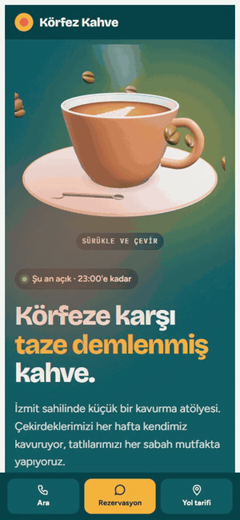
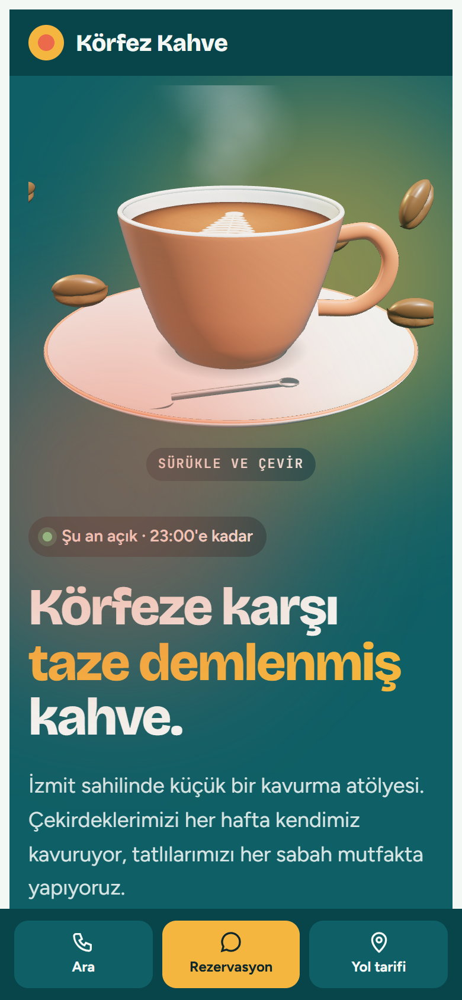
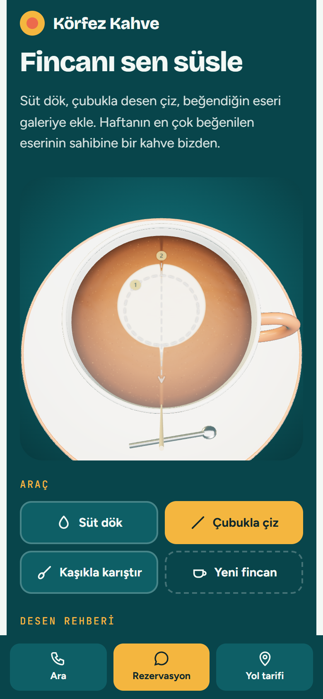
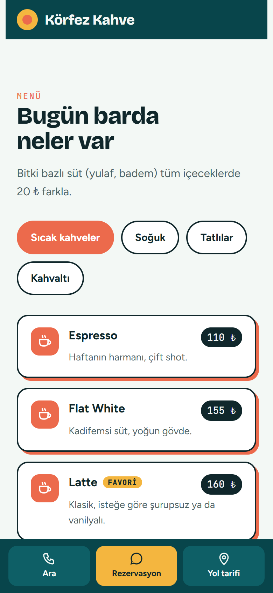
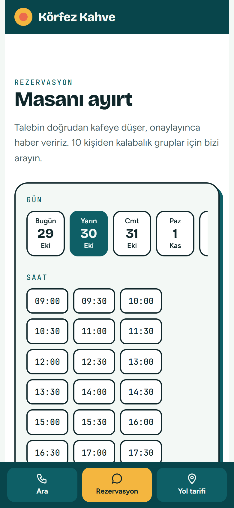
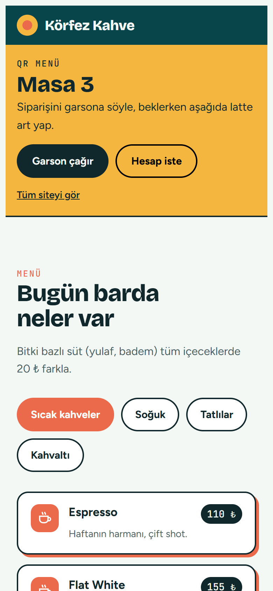
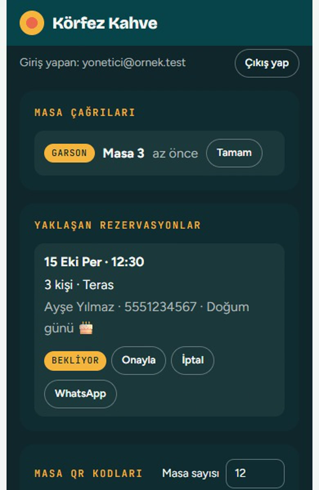
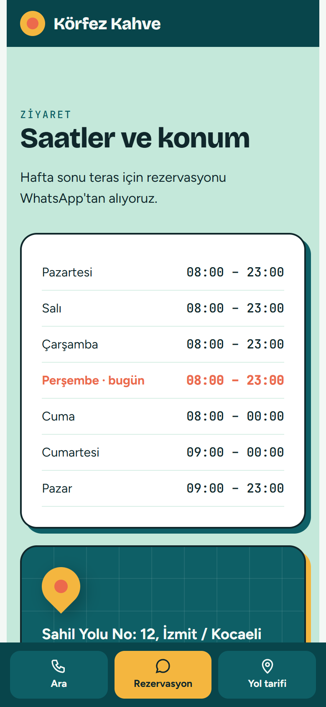

# ☕ Körfez Kahve

**Kafeler için telefona özel, 3D latte art atölyeli, QR menülü ve rezervasyonlu web sitesi**

[**🌐 Canlı demo: korfez-kahve.netlify.app**](https://korfez-kahve.netlify.app) · [🎬 Tanıtım videosu (54 sn)](gorseller/tanitim-videosu.mp4)

Körfez Kahve hayali bir mekandır; site, bir kafe için neler yapılabileceğini göstermek amacıyla hazırlanmış bir örnek çalışmadır. Mekan ve iletişim bilgileri örnektir.

---

## Neler var?

### Müşterinin gördüğü site
- **3D fincan:** sayfanın girişinde parmakla döndürülebilen, buharı tüten bir fincan.
- **Latte art atölyesi:** müşteri fincana süt döker, çubukla desen çizer, kaşıkla karıştırır. Köpük dalgalanır, kaşık fincana değince ses çıkar. Kalp, lale, rosetta ve papatya için adım adım desen rehberi var.
- **Misafir galerisi:** yapılan latte art'lar galeriye eklenir, beğeniyle haftanın favorisi seçilir.
- **Menü:** kategorili, fiyatlı, telefonda rahat okunan menü.
- **Rezervasyon:** gün, saat, kişi sayısı ve alan (teras / iç salon) seçilir. Talep doğrudan işletmenin paneline düşer; müşteri onay durumunu sitede görür, isterse WhatsApp'tan da yazar.
- **Masa QR menüsü:** masadaki QR okutulunca site o masanın menüsü olarak açılır; müşteri tek dokunuşla **garson çağırır** ya da **hesap ister**.
- **Saatler ve konum:** "şu an açık / kapalı" bilgisi, haftalık saatler, yol tarifi, arama ve WhatsApp düğmeleri.

### İşletmenin yönetim paneli
- E-posta ve şifreyle güvenli giriş.
- **Masa çağrıları:** hangi masa garson çağırdı, kim hesap istedi; canlı olarak düşer.
- **Rezervasyonlar:** onayla / iptal et, müşteriye hazır WhatsApp onay mesajı gönder.
- **Masa QR kartları:** masa sayısını yaz, her masa için baskıya hazır QR kartını indir.

## Ekran görüntüleri

<table>
  <tr>
    <td align="center"> Giriş ve 3D fincan</td>
    <td align="center"> Latte art atölyesi</td>
    <td align="center"> Menü</td>
  </tr>
  <tr>
    <td align="center"> Rezervasyon</td>
    <td align="center"> Masa QR menüsü</td>
    <td align="center"> Yönetici paneli</td>
  </tr>
  <tr>
    <td align="center"> Saatler ve konum</td>
    <td></td>
    <td></td>
  </tr>
</table>

## Her işletmeye özel

Bu site bir örnek. Her mekan için tasarım baştan, o işletmeye göre yapılır:
- işletmenin **adı, renkleri, logosu ve tarzı**
- **kendi menüsü ve fiyatları**, çalışma saatleri, adresi
- **sahibinin istediği özellikler:** latte art köşesi bir kafeye yakışır; restoranda masa QR'ı ve rezervasyon, berber ve kuaförde çalışan seçmeli randevu öne çıkar

Kafe, restoran, pastane, berber, kuaför ve benzeri yerel işletmeler için çalışıyorum.

## Teknik

- Telefona öncelikli tasarım; bilgisayarda da çalışır.
- 3D grafikler: Three.js
- Veritabanı ve giriş: Firebase (Firestore + Authentication), sıkı güvenlik kurallarıyla. Misafirler başkasının rezervasyonunu ya da masa çağrısını göremez.
- Yayın: Netlify. Aylık sunucu ücreti yok.

## İletişim

**Arda Bayrakgil**
📧 [ardabyrkgl18@gmail.com](mailto:ardabyrkgl18@gmail.com)

Kendi mekanınız için böyle bir site isterseniz yazın. Neler yapabileceğimizi konuşalım.
